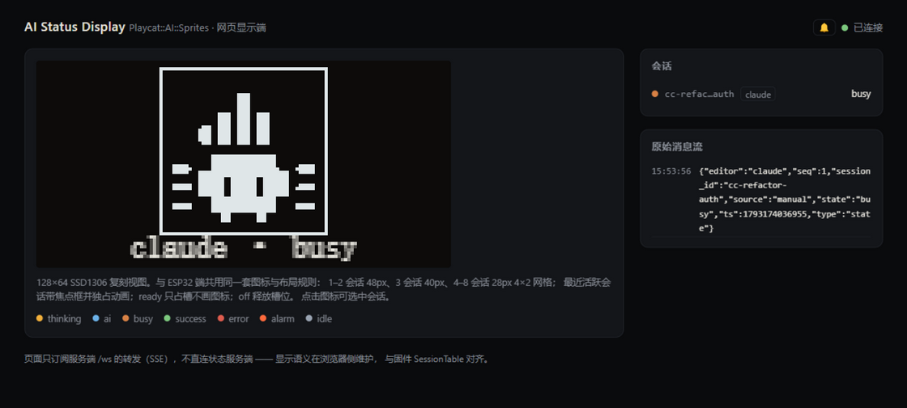
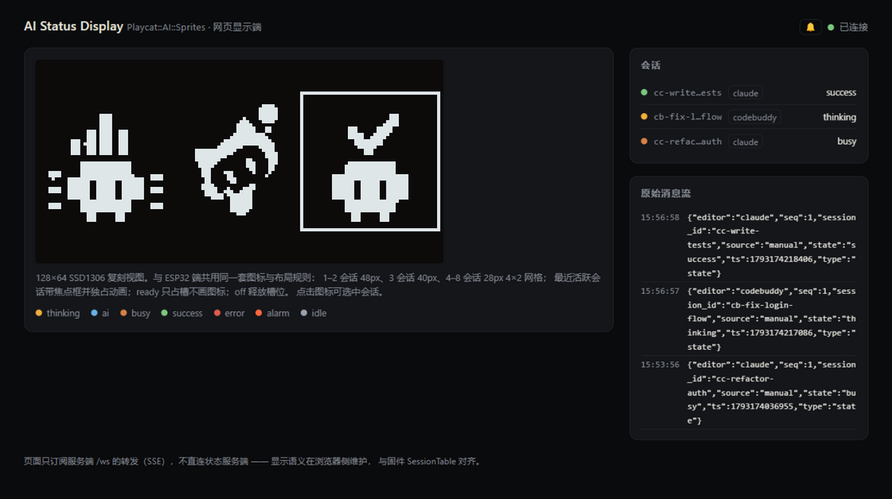
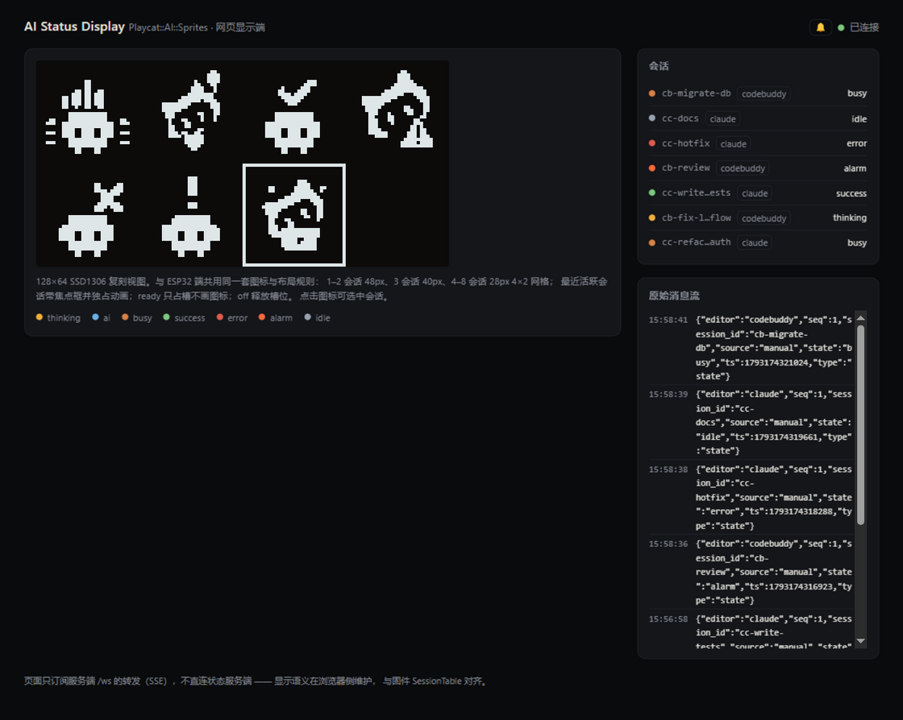

# Playcat::AI::Sprites

> 在 Vibe Coding 的时代，拥有多个 AI 编程助手已成常态——但你真的了解它们在做什么吗？
> 
> 这是一款 AI 编程助手工作监控工具，让你时刻掌握每个助手的实时状态，有效防止它们"偷懒"。兼容 Claude Code 和 CodeBuddy 等主流平台。
> 
> 核心特性：
> 
> - 实时监控 支持最多8个Agent同时工作的信息
> - 集中监控 一个服务端收集多个客户端信息并推送

## 界面预览







## 环境要求

| 组件          | 要求                      | 说明                                |
| ----------- | ----------------------- | --------------------------------- |
| Perl        | 5.40+                   | 服务端与状态来源客户端                       |
| Mojolicious | 稳定版                     | 服务端 Web/WebSocket 框架              |
| JSON::XS    | —                       | JSON 编解码                          |
| Node.js     | 22+                     | 网页客户端，只用内置模块，**无需 `npm install`** |
| 操作系统        | Windows / Linux / macOS | Windows 无 Unix socket，传输走 UDP     |

## 安装

```bash
#模块安装
cpan  Mojolicious JSON::XS
#或
cpanm Mojolicious JSON::XS
```

网页客户端零第三方依赖，装好 Node.js 即可。

## 

## 快速开始

```bash
# 1. 启动服务端（终端 A）
cd Perl && perl server.pl

# 2. 启动网页客户端（终端 B）
cd Node && node web_client.js

# 3. 浏览器打开 http://127.0.0.1:8991
```

## 接入编辑器 hook

hook 命令就一行 `client.pl --mode hook`，传输选项交给 `aisprites.json` 的
`client` 段（也可显式写 `--udp --host 127.0.0.1 --port 7788`）：

```json
{ "type": "command", "command": "perl /path/to/aisprites/Perl/client.pl --mode hook", "timeout": 2 }
```

- **Claude Code**（7 个事件：SessionStart / SessionEnd / UserPromptSubmit /
  PreToolUse / PostToolUse / Notification / Stop）：完整模板见
  `Claudeset/settings.json`，复制到 `C:\Users\<用户名>\.claude\settings.json`
  （Linux/macOS 为 `~/.claude/settings.json`），把 `client.pl` 路径改成实际安装路径。

- **CodeBuddy Code**（9 个事件，多 `PostToolUseFailure` / `PermissionRequest`，
  命令带 `--editor codebuddy`）：完整模板见 `CodebuddySet/settings.json`，把
  hooks 段合并进 `~/.codebuddy/settings.json` 或项目 `.codebuddy/settings.json`；
  **改完必须在 `/hooks` 菜单里审查放行**，未放行的 command hook 不会运行。

- Windows 下路径用正斜杠即可，例如 `perl C:/xxxx/client.pl`。

### 监听与端点

启动后同时开三个入口：

| 入口                   | 默认地址                           | 选项                                           |
| -------------------- | ------------------------------ | -------------------------------------------- |
| Unix datagram socket | `/tmp/playcat-ai-sprites.sock` | `--socket`（Windows 自动跳过；`--socket ''` 可显式禁用） |
| UDP datagram         | `0.0.0.0:8080`                 | `--udp-addr` / `--udp-port`                  |
| HTTP + WebSocket     | `http://0.0.0.0:3000`          | `--host` / `--port`                          |

| 端点           | 说明                         |
| ------------ | -------------------------- |
| `GET /`      | 健康页：连接数、当前会话数、最近一条状态       |
| `GET /state` | 最近一条状态（JSON）               |
| `WS /ws`     | 订阅状态流；建连时先推一次全量快照，断线重连不丢会话 |

```bash
curl http://127.0.0.1:3000/
# Playcat AI Sprites server ok
# clients: 1
# sessions: 2
# last: {"editor":"claude","state":"busy","source":"hook","session_id":"…","seq":3,"ts":…}
```

### 命令行选项

```text
--config PATH       配置文件（JSON，读 "server" 段）
--socket PATH       Unix datagram socket 路径（默认 /tmp/playcat-ai-sprites.sock）
--udp-addr ADDR     UDP 绑定地址（默认 0.0.0.0）
--udp-port PORT     UDP 绑定端口（默认 8080）
--host HOST         HTTP/WS 绑定地址（默认 0.0.0.0）
--port PORT         HTTP/WS 绑定端口（默认 3000）
--max-sessions N    会话表上限（默认 8，0 = 不限）
--help              帮助
```

`--max-sessions`：新会话达到上限即丢弃（不存表、不广播），已有会话的更新不受限——
正在干活的会话不会被新来的挤掉。设 `0` 为不限；调大只影响服务端记账，
各显示端仍有自己的渲染上限。

### 配置文件（aisprites.json）

服务端与客户端的公共选项可写进 JSON 配置文件，免去每次敲一长串命令行：

- **查找顺序**（取第一个存在的）：
  1. `--config PATH` 显式指定（server.pl / client.pl 均支持，选项名不支持缩写）
  2. 环境变量 `PLAYCAT_AI_SPRITES_CONFIG`
  3. 脚本所在目录的 `aisprites.json`（模板见 `aisprites.json.example`）
  4. `~/.playcat-ai-sprites/config.json`（用户级）
- **优先级**：命令行 > 配置文件 > 内置默认值。
- **键名**与命令行长选项一致，`-` 写成 `_`（如 `--udp-port` → `udp_port`）；
  文件分 `server` / `client` 两个段。
- `--mode` / `--state` 是单次调用语义，**不进**配置文件。
- 配置里开了 `udp` / `debug` 时，客户端可用 `--no-udp` / `--no-debug` 临时关掉。
- **错误处理**：服务端配置坏了直接拒绝启动（长驻进程带错配置起在默认端口更难排查）；
  客户端只警告并回退内置默认值（保住 hook 模式 exit 0、绝不阻塞编辑器的语义）。
- **Windows**：没有 Unix socket，服务端自动跳过 Unix listener；客户端配置
  `"udp": true` 即可，hook 命令无需再带传输参数。

```json
{
  "server": { "udp_addr": "0.0.0.0", "udp_port": 7788, "host": "0.0.0.0", "port": 3000 },
  "client": { "udp": true, "host": "127.0.0.1", "port": 7788 }
}
```

## 状态来源（client.pl）

`client.pl` 是服务端的数据来源：编辑器通过 hook 调用它（读 stdin 的事件 JSON、
推断状态、发 datagram）

### 命令行选项

```text
--editor EDITOR     编辑器适配器：claude（默认）| codebuddy
--config PATH       配置文件（JSON，读 "client" 段）
--socket PATH       Unix datagram socket（默认 /tmp/playcat-ai-sprites.sock）
--udp / --no-udp    用 / 不用 UDP 传输（可覆盖配置文件的 udp）
--host HOST         UDP 服务端地址（默认 127.0.0.1）
--port PORT         UDP 服务端端口（默认 8080）
--state STATE       显式指定状态（配合 --mode send；只认当前适配器的状态表）
--debug / --no-debug
--debug-file PATH   调试转储路径（默认 ~/.playcat-ai-sprites/client-debug.jsonl）
--help              帮助
```

## 网页客户端（web_client.js）

零第三方依赖（Node 22+ 内置模块）。它订阅服务端的 `/ws`，把收到的帧原样转成
SSE 推给浏览器，并托管 `public/` 静态页面——浏览器不直连状态服务端。

```bash
cd Node
node web_client.js                                                    # 默认 :8991 → 127.0.0.1:3000
node web_client.js --port 8991 --server 192.168.3.201 --server-port 3000
```

```text
--port PORT         页面服务端口（默认 8991）
--server HOST       状态服务端地址（默认 127.0.0.1）
--server-port PORT  状态服务端端口（默认 3000）
--help              帮助
```

### 页面内容

浏览器打开 `http://127.0.0.1:8991`：

- **状态面板**：每个会话一个图标，最多 8 槽，与显示端同一套会话表语义
  （`ready` 隐形占位、`idle` 待机、`off` 删除、最近有事件的会话带焦点描边、
  满表优先驱逐隐形槽）。
- **连接状态**：与状态服务端的连接情况。
- **会话列表**：当前所有会话及各自状态。
- **消息流**：每条事件的实时流水（时间戳 + 内容）。
- **提示音**：会话切到 `success` / `error` 时播放；浏览器音频策略要求先在
  页面上点击一次解锁。

## 常见问题

**服务端没启动，hook 会卡住编辑器吗？**
不会。客户端连接失败时静默返回，`--mode hook` 退出码恒为 0、stdout 为空；
只是状态无处可去，页面会一直空着。

**用 UDP 还是 Unix socket？**
同机部署用默认 Unix socket；跨机器或 Windows 用 UDP（客户端 `--udp` 或配置文件
`"udp": true`）。功能一致；UDP 不保证送达，本机/局域网内损耗可忽略。

**换端口 / 换机器要改哪些地方？**
三处对齐即可：服务端 `--port` / `--udp-port`（或配置文件 `server` 段）、
客户端 `--host` / `--port`（跨机器时 `--host` 填服务端地址）、
网页客户端 `--server` / `--server-port`。

**Socket 文件残留？**
服务端启动时会先清残留 socket 再绑定，SIGINT/SIGTERM 退出也会清理；
被 `kill -9` 后手动删除 `/tmp/playcat-ai-sprites.sock` 即可。

**会话图标残留不消失？**
会话表不做超时清除，`SessionEnd`（`off`）是唯一能清会话的事件。编辑器进程被
强杀、机器休眠时收不到它，会话会留到服务端重启为止（服务端重启后快照清空，
订阅端重连即清屏）。

**超过 8 个会话会怎样？**
服务端默认 `--max-sessions 8` 先挡，新会话达上限即丢弃，已有会话的更新不受限；
`--max-sessions 0` 为不限（只影响服务端记账）。
